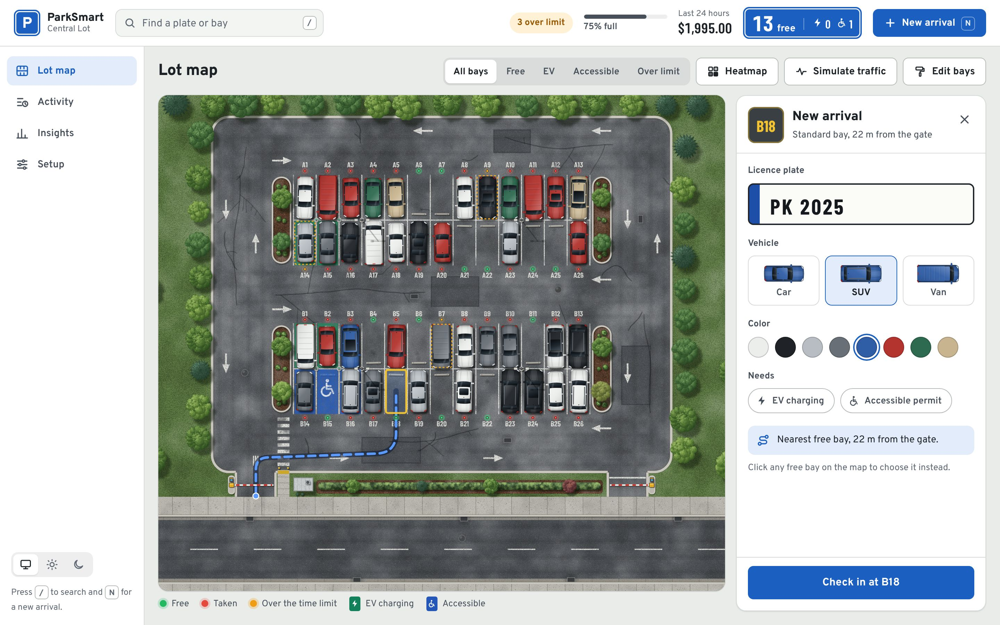

# ParkSmart

ParkSmart is a parking lot manager that runs in the browser. It shows every bay on a live map of the lot, checks cars in and out with the right fee, sends each arrival to the best free bay, and keeps a history you can search, chart and export.



There is no build step and nothing to install: open `index.html` and it works.

## What it does

- **Live lot map.** All 52 bays seen from above and drawn to scale like an aerial photo: worn asphalt with oil stains, patches and sealed cracks, faded white paint, wheel stops, kerbs and planted islands, trees and light poles casting shadows, and the street outside. Cars come in four body styles with their own shadows. Sensor lights show each bay's state (green free, red taken, amber over the time limit), and EV bays have charge points.
- **Check in.** Enter a plate, pick the vehicle and color, and mark EV or accessible needs. ParkSmart suggests the best free bay and draws the route from the gate. The car then drives in from the street.
- **Check out.** See the time parked and an itemised receipt, choose card, cash or app, then print the receipt. The car backs out and leaves through the exit gate.
- **Move a car** to another free bay, for when someone parks in the wrong place.
- **Find any car** by plate or bay from the search box. Cars that have left show when they left.
- **Time limit alerts** flag cars parked longer than the limit you set.
- **Activity** lists who is parked now and every finished visit, filterable and exportable to CSV.
- **Insights** for the last 24 hours: revenue, visits, average stay, occupancy over time, revenue by hour, length of stay, busiest bays and payment methods.
- **Heatmap** colours each bay by how much of the last 24 hours it was taken.
- **Setup** for the lot name, currency, rates, grace period, daily maximum and time limit, with a live price preview. Bays can be repainted as standard, EV charging or accessible straight on the map.
- **Traffic simulation** sends cars in and out on their own, which is handy for demos.
- **Light and dark themes**, a phone layout with a bottom sheet, full keyboard use and screen reader labels.

The first time it opens, the lot is filled with a believable day of demo data. **Setup → Empty the lot** clears it so you can start with real cars.

## Running it

Open `index.html` in a current version of Chrome, Edge, Firefox or Safari.

If you prefer a local server (some browsers limit pages opened straight from disk):

```bash
python3 -m http.server 8000
# then visit http://localhost:8000
```

Everything is saved in the browser's local storage, so it survives a reload. Use **Setup → Download backup** to keep a copy or move it to another computer, and **Restore backup** to load it again.

The interface uses the Overpass and Barlow Condensed fonts from Google Fonts. Without a connection it falls back to system fonts and still works.

## Using it

| To | Do this |
| --- | --- |
| Check a car in | **New arrival** (or press `N`), or click a free bay |
| Check a car out | Click the car's bay, then **Check out** |
| Move a car | Click its bay, then **Move to another bay**, then click a free bay |
| Find a car | Type in the search box (press `/` to jump there) |
| Repaint bays | **Edit bays**, then click a bay to cycle standard → EV charging → accessible |

### Keyboard

| Key | Action |
| --- | --- |
| `/` | Search for a plate or bay |
| `N` | New arrival |
| Arrow keys | Move between bays on the map, `Home` and `End` jump to the ends of a row |
| `Enter` or `Space` | Open the focused bay |
| `Esc` | Close the panel, cancel a move, or finish editing bays |

## How fees work

Every started hour is charged: the first hour at one rate and each extra hour at another. Stays shorter than the grace period are free, and the daily maximum caps each 24-hour block.

With the default rates (10 minutes free, $3 for the first hour, $2 for each extra hour, $20 a day at most):

- 8 minutes costs nothing.
- 2 hours 15 minutes is 3 started hours: $3 + 2 × $2 = **$7**.
- 30 hours is one full day ($20) plus 6 hours of the next ($3 + 5 × $2 = $13): **$33**.

All amounts are stored in cents, so there are no rounding errors.

## How bays are chosen

- **Accessible permit:** the free accessible bay closest to the booth by the entrance. If none are free, the closest bay to the booth.
- **Electric vehicle:** the nearest free charging bay by driving distance from the gate. If none are free, the nearest standard bay.
- **Everyone else:** the nearest free standard bay, so charging and accessible bays stay free for the people who need them.

Any free bay can still be picked by clicking it on the map.

## Project structure

```
index.html        Page structure
css/style.css     All styles: tokens, layout, the map, dark theme, phone layout, print
js/config.js      Lot geometry, bay types and default settings
js/utils.js       Helpers for formatting, licence plates and downloads
js/pricing.js     Fee rules and the receipt breakdown
js/store.js       State, actions, validation and local storage
js/demo.js        The demo day and random arrivals for the simulation
js/routing.js     The road network, driving routes and bay choice
js/stats.js       Occupancy, revenue and usage figures
js/scene.js       The ground, painted on a canvas: asphalt, paint, kerbs, lawn, street, trees
js/lot-map.js     The map on top in SVG: bays, cars, sensor lights, driving animation, keyboard use
js/charts.js      Small SVG charts for Insights
js/views.js       Activity, Insights and Setup
js/app.js         Top bar, side panel, checkout, search, shortcuts and simulation
docs/             Screenshots for this README
```

The scripts are plain JavaScript with no framework or dependencies. They share one `window.PS` namespace and load in the order listed in `index.html`.

### Data

State is saved under the `parksmart:v2` key in local storage:

```js
{
  settings: { lotName, currency, graceMinutes, firstHour, extraHour, dailyMax, maxStayHours, theme },
  bayTypes: { A1: 'standard', A14: 'ev', B14: 'accessible', ... },
  sessions: { B3: { plate, kind, color, entered, needs: { ev, accessible } }, ... },  // cars parked now
  history:  [ { plate, spot, entered, exited, fee, method }, ... ]                  // finished visits, fee in cents
}
```

Saved data and restored backups are validated before use, so a damaged file cannot break the app.

## Changes from the first version

The first version drew the lot from background images and let you click a bay to toggle a random car picture on or off. This version keeps the same layout of two blocks with bays A1 to A26 and B1 to B26, and finishes the app around it:

- Each car now has a plate, vehicle, color and arrival time. Fees, receipts, history, search, insights and backups are new.
- The lot is drawn in code instead of 4.4 MB of images: a canvas for the ground and SVG for everything you can click. It scales to any screen and works on phones.
- Fixed bay B15, which had the id `A15` and showed the wrong label after a car left.
- Fixed the layout, which was fixed to 2060 × 1000 pixels and cut off on most screens.
- Pinch zoom is no longer blocked, and the map can be used with a keyboard or a screen reader.

## Credits

ParkSmart was started by Sema Yasharova.
